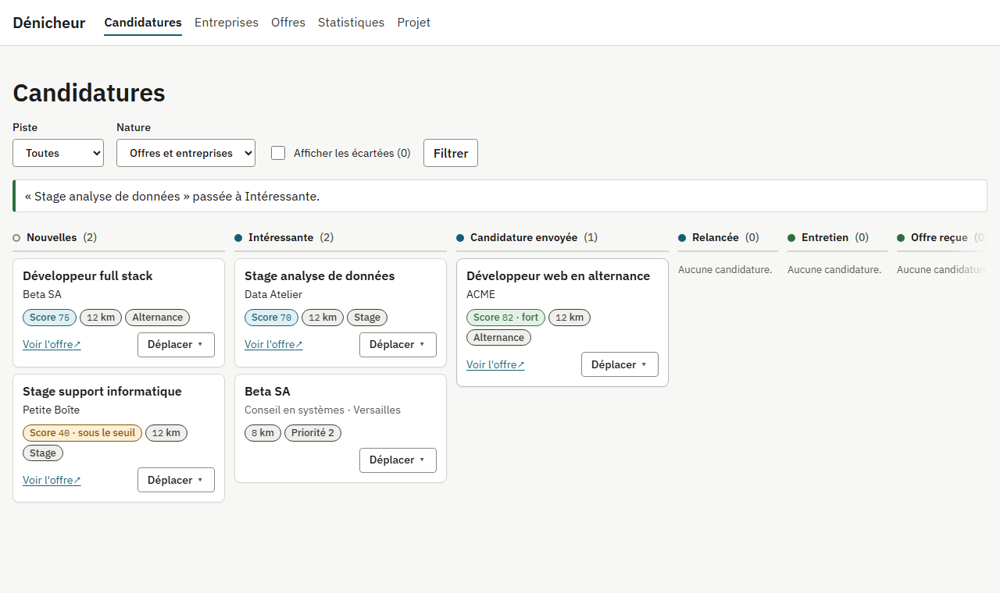
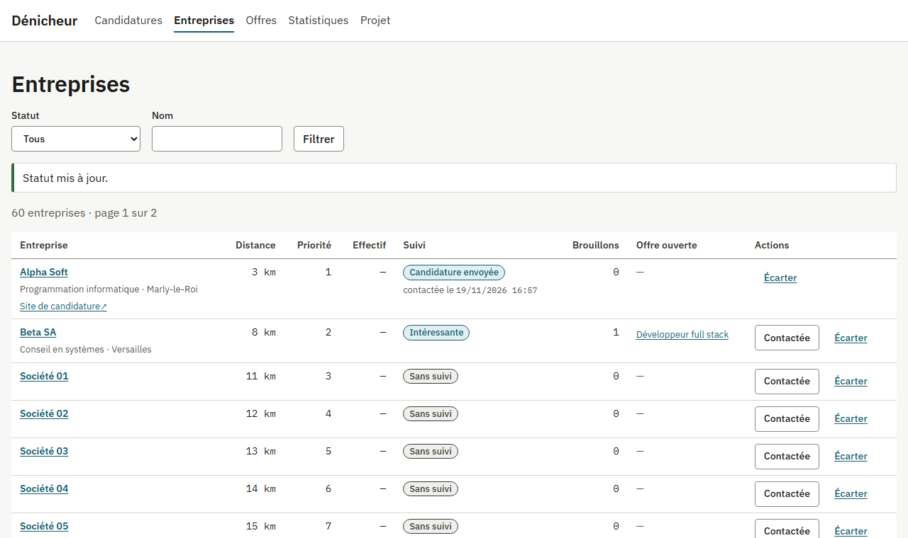
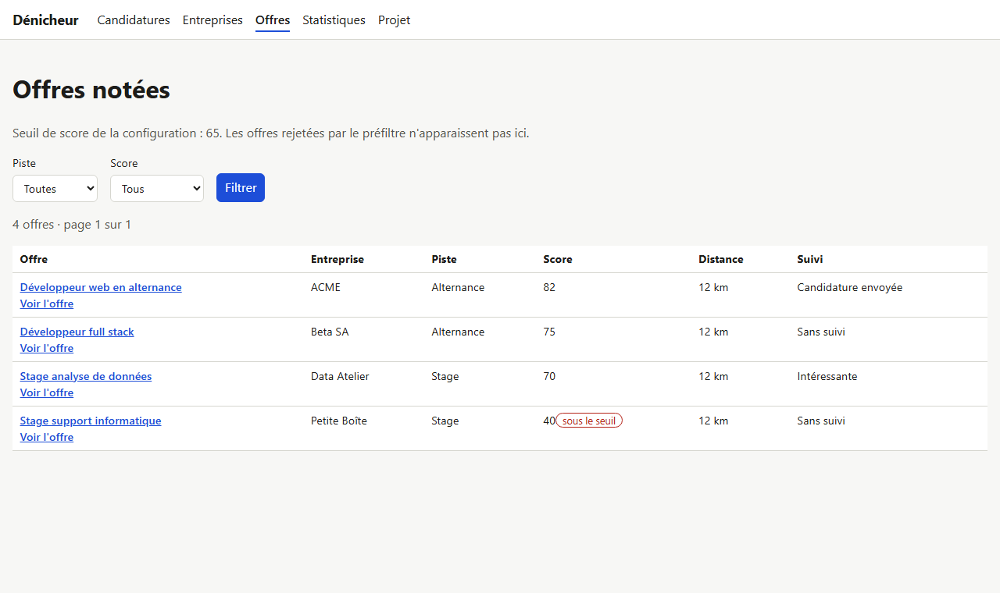
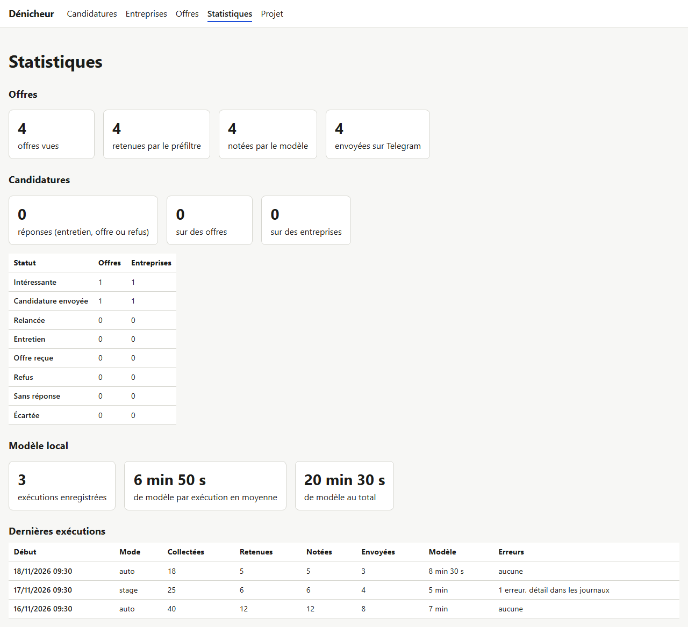
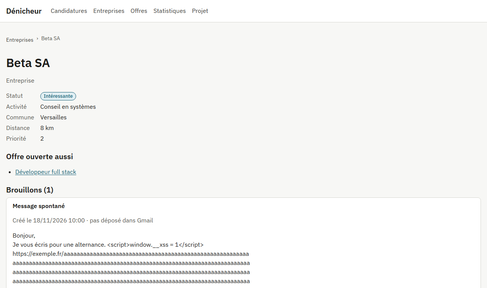

# Dénicheur

Assistant personnel de recherche d'**alternance** (priorité) et de **stage**. Il collecte les offres via des sources officielles et les alertes e-mail, les évalue avec un LLM **local** (Ollama) par rapport au profil du candidat, puis envoie un digest en français sur Telegram. Il prépare aussi des brouillons de candidature (e-mail, relance, lettre PDF/DOCX). **L'envoi d'une candidature reste toujours une décision humaine : rien n'est jamais envoyé automatiquement.**

> Projet 100 % local et gratuit : Ollama, SQLite, Planificateur de tâches Windows, bot Telegram en polling. Aucun service payant ni cloud.

## Table des matières

- [Fonctionnalités](#fonctionnalités)
- [Stack technique](#stack-technique)
- [Fonctionnement](#fonctionnement)
- [Sources de données](#sources-de-données)
- [Prérequis](#prérequis)
- [Installation pas à pas](#installation-pas-à-pas)
- [Configuration](#configuration)
  - [Variables d'environnement (`.env`)](#variables-denvironnement-env)
  - [Réglages de recherche (`config/recherches.yaml`)](#réglages-de-recherche-configrecherchesyaml)
  - [Fichiers de profil](#fichiers-de-profil)
- [Commandes](#commandes)
  - [Commandes Python](#commandes-python)
  - [Modes de `run`](#modes-de-run)
  - [Commandes du dossier `web/`](#commandes-du-dossier-web)
  - [Contrôles avant commit](#contrôles-avant-commit)
- [Tâches planifiées Windows](#tâches-planifiées-windows)
  - [Installer les tâches](#installer-les-tâches)
  - [Voir l'état des tâches](#voir-létat-des-tâches)
  - [Désactiver, arrêter, supprimer les tâches](#désactiver-arrêter-supprimer-les-tâches)
  - [Réactiver les tâches](#réactiver-les-tâches)
  - [Lancer une tâche à la main](#lancer-une-tâche-à-la-main)
  - [Suspendre les envois sans toucher aux tâches](#suspendre-les-envois-sans-toucher-aux-tâches)
  - [Logs](#logs)
- [Bot Telegram](#bot-telegram)
- [Candidatures spontanées](#candidatures-spontanées)
- [Brouillons et lettres](#brouillons-et-lettres)
- [Alertes e-mail (Gmail)](#alertes-e-mail-gmail)
- [Tableau de bord](#tableau-de-bord)
- [Base de données](#base-de-données)
- [Architecture](#architecture)
- [Tests](#tests)
- [Dépannage](#dépannage)
- [Sécurité et vie privée](#sécurité-et-vie-privée)
- [Documentation et workflow](#documentation-et-workflow)

## Fonctionnalités

- Collecte des offres d'alternance (La bonne alternance), de stage (Adzuna) et des alertes e-mail (Indeed, Jobtome) lues dans Gmail en lecture seule.
- Dédoublonnage (par URL et par entreprise + titre normalisé), filtre de distance (25 km autour de Mareil-Marly) et filtre par mots-clés.
- Scoring par un LLM local avec un barème, sortie JSON validée, plafonds d'appels par jour et par run.
- Digest Telegram quotidien et alertes immédiates pour les meilleures offres d'alternance, avec boutons d'action.
- Suivi des candidatures (statuts, rappel à J+7, une relance par candidature).
- Brouillons d'e-mail, relances et lettres de motivation (PDF et DOCX), dépôt dans les brouillons Gmail (IMAP APPEND), jamais d'envoi.
- Candidatures spontanées : table d'entreprises, import CSV, recruteurs La bonne alternance, recherche d'entreprises par département, liste du jour.
- Tableau de bord web local (SvelteKit) : kanban, listes, fiches, statistiques.
- Deux tâches planifiées Windows : `Denicheur` (collecte) et `DenicheurBot` (bot).

## Stack technique

| Élément | Choix |
|---|---|
| Langage | Python 3.13 (3.12 minimum, `requires-python = ">=3.12"`) |
| Bibliothèques | httpx, pydantic 2, SQLAlchemy 2, Alembic, PyYAML, python-dotenv, tzdata, fpdf2, python-docx |
| Outils de dev | pytest, ruff, mypy, types-PyYAML, pypdf |
| Données | SQLite locale (`denicheur.db`), migrations Alembic dans `migrations/` |
| LLM | Ollama en local, modèle `llama3.1:8b` (scoring et écriture, réglages dans `config/recherches.yaml`) |
| Notifications | API Telegram Bot, en polling (pas de webhook) |
| Courrier | IMAP Gmail (lecture des alertes, dépôt de brouillons) avec mot de passe d'application |
| Exécution | `py -m denicheur run`, planifié par le Planificateur de tâches Windows |
| Tableau de bord | SvelteKit (dossier `web/`), Node.js 22+, IBM Plex en local, tests Vitest et Playwright |
| Zone | 25 km autour de Mareil-Marly (78), INSEE 78367 |

## Fonctionnement

```text
collecte → dédoublonnage → filtres (distance, mots-clés) → scoring LLM → digest Telegram
```

1. **Collecte** : chaque source renvoie des `Offre` normalisées (`src/denicheur/sources/`). Une source dont la clé manque dans `.env` est ignorée sans erreur.
2. **Dédoublonnage** : clé `cle_dedup` (entreprise + titre normalisé) et URL unique en base.
3. **Filtres** : distance (haversine, `rayon_km`), mots-clés du titre (`mots_cles_titre`), mots exclus (`mots_exclus`), âge maximal (`age_max_jours`), villes hors zone (`config/villes_hors_zone.txt`). Les offres rejetées gardent leur `motif_rejet`.
4. **Scoring** : Ollama note chaque offre retenue (0 à 100) avec points forts, points faibles, alerte et projet à citer. Plafonds : `llm_max_appels_jour` et `llm_max_duree_run_s`.
5. **Notification** : alerte immédiate pour l'alternance au-dessus de `alerte_immediate_alternance_min`, digest à `heure_digest`, offres au-dessus de `score_min`, au plus `digest_max_offres`.
6. **Journal** : chaque run écrit une ligne dans `executions` (compteurs, erreurs, durée LLM).

Le mode `auto` décide selon l'heure de Paris (la tâche tourne sur l'heure locale, la base est en UTC) : l'alternance est collectée toutes les `frequence_heures` heures dans la plage `plage_alertes` (08:00-20:00), le stage une fois par jour, le digest à `heure_digest`.

## Sources de données

| Source | Usage | Statut |
|---|---|---|
| La bonne alternance (API) | Offres d'alternance et entreprises pour candidature spontanée | Fonctionne |
| Adzuna | Stages (une collecte par jour, `run --mode stage` pour la forcer) | Codé |
| E-mails d'alerte (Indeed, Jobtome, puis WTTJ, LinkedIn, JobTeaser) via Gmail | Offres des grands sites, sans scraping | Indeed et Jobtome codés ; les autres : un analyseur par expéditeur dès qu'un e-mail réel existe |
| Recherche d'entreprises (`recherche-entreprises.api.gouv.fr`) | PME informatiques par département et code NAF | Fonctionne |
| France Travail (Offres v2, La Bonne Boite v2) | Offres complémentaires | Accès non obtenu |

Aucun scraping de pages protégées, aucun contournement de CAPTCHA, aucun envoi automatique de candidature. La bonne alternance : 60 requêtes par minute, usage non lucratif.

## Prérequis

- Windows 10/11 (le Planificateur de tâches et les scripts `.ps1` sont propres à Windows).
- Python 3.12 ou plus récent avec le lanceur `py`.
- [Ollama](https://ollama.com) installé et lancé (`http://localhost:11434`), avec le modèle `llama3.1:8b`.
- Node.js 22 ou plus récent (uniquement pour le tableau de bord).
- Un bot Telegram créé avec @BotFather (jeton et `chat_id`).
- Une clé API La bonne alternance (gratuite).
- Optionnel : clés Adzuna (stages), compte Gmail avec double authentification et mot de passe d'application (alertes et brouillons).

## Installation pas à pas

```bash
# 1. Cloner le dépôt (il doit rester privé)
git clone <url-du-depot> denicheur
cd denicheur

# 2. Installer le paquet et les outils de dev
py -m pip install -e ".[dev]"

# 3. Récupérer le modèle local
ollama pull llama3.1:8b

# 4. Créer le fichier de secrets, puis le remplir
cp .env.example .env

# 5. Créer la base (migrations Alembic)
py -m denicheur init-db

# 6. Écrire /start à ton bot dans Telegram, puis afficher le chat.id à copier dans .env
py -m denicheur setup-telegram

# 7. Vérifier l'envoi avec une offre factice
py -m denicheur digest --test

# 8. Premier run sans envoi Telegram
py -m denicheur run --mode auto --dry-run

# 9. Installer les tâches planifiées (voir la section dédiée)
powershell -ExecutionPolicy Bypass -File scripts\installer_taches.ps1
```

Ordre conseillé pour obtenir les identifiants : jeton du bot (@BotFather) → `TELEGRAM_BOT_TOKEN` → `/start` au bot → `setup-telegram` → `TELEGRAM_CHAT_ID`.

## Configuration

### Variables d'environnement (`.env`)

Les secrets se placent uniquement dans `.env`, ignoré par git (modèle : `.env.example`). Une variable vide équivaut à une variable absente.

| Variable | Rôle | Défaut |
|---|---|---|
| `LBA_API_KEY` | Clé de l'API La bonne alternance (source ignorée sans elle) | - |
| `TELEGRAM_BOT_TOKEN` | Jeton du bot Telegram | - |
| `TELEGRAM_CHAT_ID` | Seul `chat_id` autorisé : tout autre utilisateur est ignoré | - |
| `ADZUNA_APP_ID`, `ADZUNA_APP_KEY` | Source stages (ignorée sans les deux) | - |
| `GMAIL_USER`, `GMAIL_APP_PASSWORD` | Lecture des alertes et dépôt des brouillons Gmail (mot de passe d'application) | - |
| `LETTRES_DIR` | Dossier de sortie des lettres | `lettres motivation taf` sur le Bureau |
| `DATABASE_URL` | Base de données | `sqlite:///denicheur.db` |
| `FT_CLIENT_ID`, `FT_CLIENT_SECRET` | France Travail, uniquement si l'accès est accordé | - |

Variables du tableau de bord (pas dans `.env`) : `DB_PATH` (fichier SQLite), `CONFIG_PATH` (fichier de réglages), `PORT` (défaut 3000).

### Réglages de recherche (`config/recherches.yaml`)

| Clé | Rôle | Valeur actuelle |
|---|---|---|
| `centre`, `rayon_km` | Point central et rayon de recherche | Mareil-Marly, 25 km |
| `inclure_teletravail` | Garder les offres en télétravail | `false` |
| `niveau_vise` | Niveau de diplôme visé | `"6"` |
| `pistes.alternance` | Codes ROME, durée, fréquence de collecte | M1805/M1806/M1807, 12-24 mois, toutes les 3 h |
| `pistes.stage` | Lieu, mots-clés Adzuna, durée, début | Marly-le-Roi, 5-6 mois, 2027-01/02, toutes les 24 h |
| `mots_cles_titre` | Au moins un mot dans le titre | développeur, web, data, python... |
| `mots_exclus` | Un seul de ces mots rejette l'offre | senior, confirmé, manager, lead... |
| `mots_bonus` | Mots qui favorisent une offre | claude code, cursor, copilot |
| `age_max_jours` | Âge maximal d'une offre | 30 |
| `score_min` | Score minimal pour le digest | 65 |
| `alerte_immediate_alternance_min` | Score déclenchant une alerte immédiate | 80 |
| `digest_max_offres` | Taille maximale du digest | 10 |
| `plage_alertes` | Plage horaire des alertes | 08:00-20:00 |
| `heure_digest` | Heure du digest quotidien | 08:30 |
| `llm.scoring`, `llm.ecriture` | Modèle, température, `num_ctx`, délai | `llama3.1:8b`, 0.0 et 0.7 |
| `llm_max_appels_jour`, `llm_max_duree_run_s` | Plafonds d'appels et de durée | 150 et 900 s |
| `entreprises` | NAF, départements, effectifs, `liste_par_jour`, `brouillons_max_jour`, `pages_max` | voir fichier |

Ne jamais changer le modèle ni les options entre deux requêtes du même type (scoring toujours avec `scoring`, écriture toujours avec `ecriture`).

### Fichiers de profil

| Fichier | Rôle | Versionné |
|---|---|---|
| `profile/profil.md` | Profil envoyé au LLM (sans données personnelles) | oui |
| `profile/regles_ecriture.md`, `profile/lettre_modele.md` | Style d'écriture et modèle de lettre | oui |
| `profile/identite.md` | En-tête et signature des lettres, jamais lu par le LLM | non |
| `profile/liens.md` | Liens GitHub et LinkedIn sous la signature | non |
| `profile/cv_*.md`, `CV_base/` | CV avec coordonnées | non |

## Commandes

### Commandes Python

| Commande | Description |
|---|---|
| `py -m pip install -e ".[dev]"` | Installe le projet et les outils de dev |
| `py -m denicheur init-db` | Crée ou met à jour le schéma de `denicheur.db` (migrations) |
| `py -m denicheur setup-telegram` | Affiche le `chat.id` à copier dans `.env` (après un `/start` au bot) |
| `py -m denicheur digest --test` | Envoie une offre factice sur Telegram |
| `py -m denicheur digest` | Envoie le digest des offres notées non encore notifiées |
| `py -m denicheur run` | Collecte, filtre, note et notifie (mode `auto`) |
| `py -m denicheur run --mode auto\|alternance\|stage\|digest` | Force un mode (voir ci-dessous) |
| `py -m denicheur run --dry-run` | Même cycle, sans aucun message Telegram |
| `py -m denicheur bot` | Bot Telegram en polling (boutons et commandes) ; Ctrl+C pour l'arrêter |
| `py -m denicheur import-entreprises <fichier.csv>` | Importe une liste d'entreprises (CSV UTF-8, séparateur `;`) |
| `py scripts/make_fixture.py` | Régénère `tests/fixtures/lba_search.json` depuis `data/ft_test_results.json` |
| `py scripts/compare_modeles.py` | Compare des modèles Ollama sur des offres étiquetées |
| `py scripts/test_france_travail.py` | Teste les API (`FT_TEST=offres\|lbb\|entreprises\|alternance` pour un seul test) |

`py -m denicheur stats` est déclaré mais pas encore implémenté (il affiche « non implémenté ») ; les statistiques sont dans le tableau de bord et la commande Telegram `/stats`.

### Modes de `run`

| Mode | Effet |
|---|---|
| `auto` | Décide selon l'heure et l'état en base : alternance si l'échéance est passée, stage une fois par jour, digest à l'heure prévue |
| `alternance` | Force la collecte des offres d'alternance |
| `stage` | Force la collecte Adzuna (stages) |
| `digest` | Envoie le digest sans collecter |

Le code retour est `0` si le run est sans erreur, `1` sinon (les erreurs sont aussi affichées et stockées dans `executions.erreurs`).

### Commandes du dossier `web/`

| Commande | Description |
|---|---|
| `npm install` | Installe les dépendances (une seule fois) |
| `npm run build` | Compile l'application (après chaque mise à jour du code) |
| `npm start` | Lance le tableau sur `http://127.0.0.1:3000` |
| `npm run dev` | Serveur de développement Vite |
| `npm run check` | Vérification des types (svelte-check) |
| `npm test` | Tests unitaires (Vitest) |
| `npm run e2e` | Tests Playwright sur une base de démonstration (`npx playwright install chromium` la première fois) |
| `npm run captures` | Régénère les captures dans `docs/captures/` |

### Contrôles avant commit

```bash
py -m ruff format --check . && py -m ruff check . && py -m mypy src && py -m pytest -q
cd web && npm run check && npm test && npm run build && npm run e2e
```

## Tâches planifiées Windows

Le script `scripts/installer_taches.ps1` crée deux tâches pour l'utilisateur courant, sans droits administrateur.

| Tâche | Rôle | Déclencheur | Réglages notables |
|---|---|---|---|
| `Denicheur` | `py -m denicheur run --mode auto`, sortie dans `logs\run.log` | Tous les jours à 08:30, répété toutes les heures pendant 12 h | Rattrape un run manqué (`StartWhenAvailable`), pas de second exemplaire en parallèle, arrêt après 30 min |
| `DenicheurBot` | `py -m denicheur bot`, sortie dans `logs\bot.log` | À l'ouverture de session | Relancé toutes les minutes s'il s'arrête (jusqu'à 999 fois), sans limite de durée, actif sur batterie |

Les deux tâches sont enregistrées en mode `S4U` (« exécuter même si l'utilisateur n'est pas connecté », sans mot de passe) : elles tournent **sans aucune fenêtre**, ni à l'écran ni dans la barre des tâches. Contrepartie : pas de console à fermer, le bot ne s'arrête que par `Stop-ScheduledTask -TaskName 'DenicheurBot'` et se suit dans `logs\bot.log`. Limite de S4U : pas d'accès réseau avec ton identité Windows (inutile ici). Si l'installation répond « Accès refusé », ouvre PowerShell en administrateur pour cette seule fois.

Les commandes utilisent l'interpréteur de `.venv\Scripts\python.exe` s'il existe, sinon le `python` du PATH, avec le dépôt comme répertoire de travail.

> Toutes les commandes PowerShell ci-dessous se lancent dans un terminal PowerShell ordinaire (pas besoin d'administrateur, les tâches appartiennent à ton compte).

### Installer les tâches

```powershell
powershell -ExecutionPolicy Bypass -File scripts\installer_taches.ps1
```

Le script est idempotent : `-Force` remplace une tâche existante, il ne crée jamais de doublon. **Attention : il réactive aussi les tâches que tu avais désactivées.**

### Voir l'état des tâches

```powershell
# État (Ready, Running, Disabled)
Get-ScheduledTask -TaskName 'Denicheur', 'DenicheurBot' | Select-Object TaskName, State, @{n='LogonType';e={$_.Principal.LogonType}}

# Le bot tourne-t-il, et sans fenêtre ? (python présent, MainWindowHandle à 0)
Get-Process python, cmd -ErrorAction SilentlyContinue | Select-Object Id, ProcessName, MainWindowHandle

# Dernier lancement, résultat et prochain lancement
Get-ScheduledTaskInfo -TaskName 'Denicheur'    | Select-Object LastRunTime, LastTaskResult, NextRunTime
Get-ScheduledTaskInfo -TaskName 'DenicheurBot' | Select-Object LastRunTime, LastTaskResult, NextRunTime

# Équivalent en ligne de commande classique
schtasks /Query /TN "Denicheur" /V /FO LIST
schtasks /Query /TN "DenicheurBot" /V /FO LIST
```

`LastTaskResult` à `0` signifie succès ; `267009` signifie « en cours d'exécution » (normal pour le bot).

### Désactiver, arrêter, supprimer les tâches

Trois niveaux, du plus réversible au plus définitif.

**1. Désactiver une tâche (elle ne se déclenchera plus, la définition est conservée)**

```powershell
# Arrêter la collecte planifiée
Disable-ScheduledTask -TaskName 'Denicheur'

# Empêcher le bot de démarrer à la prochaine ouverture de session
Disable-ScheduledTask -TaskName 'DenicheurBot'

# Les deux d'un coup
'Denicheur', 'DenicheurBot' | ForEach-Object { Disable-ScheduledTask -TaskName $_ }
```

Équivalent `schtasks` :

```bat
schtasks /Change /TN "Denicheur" /DISABLE
schtasks /Change /TN "DenicheurBot" /DISABLE
```

**2. Arrêter ce qui tourne maintenant** (désactiver n'interrompt pas un processus déjà lancé)

```powershell
# Arrêter l'instance en cours de la tâche (le bot tourne en continu : c'est ce qu'il faut faire pour le couper)
Stop-ScheduledTask -TaskName 'DenicheurBot'
Stop-ScheduledTask -TaskName 'Denicheur'

# Équivalent schtasks
schtasks /End /TN "DenicheurBot"
schtasks /End /TN "Denicheur"
```

Si le bot ne s'arrête pas (par exemple parce qu'il a été lancé à la main dans un terminal), repère puis termine le processus :

```powershell
# Processus Python qui exécutent le bot ou le run
Get-CimInstance Win32_Process -Filter "Name = 'python.exe' OR Name = 'py.exe'" |
  Where-Object { $_.CommandLine -match 'denicheur' } |
  Select-Object ProcessId, CommandLine

# Terminer un processus précis (remplace 1234 par le ProcessId lu ci-dessus)
Stop-Process -Id 1234
```

Pour couper complètement le tout, dans cet ordre : désactiver les deux tâches, arrêter les deux tâches, vérifier qu'aucun processus `denicheur` ne reste.

```powershell
'Denicheur', 'DenicheurBot' | ForEach-Object { Disable-ScheduledTask -TaskName $_; Stop-ScheduledTask -TaskName $_ }
Get-ScheduledTask -TaskName 'Denicheur', 'DenicheurBot' | Select-Object TaskName, State   # attendu : Disabled
```

**3. Supprimer définitivement les tâches** (il faudra relancer `installer_taches.ps1` pour les recréer)

```powershell
Unregister-ScheduledTask -TaskName 'Denicheur'    -Confirm:$false
Unregister-ScheduledTask -TaskName 'DenicheurBot' -Confirm:$false

# Équivalent schtasks
schtasks /Delete /TN "Denicheur" /F
schtasks /Delete /TN "DenicheurBot" /F
```

**Interface graphique** : `Win + R`, taper `taskschd.msc`, ouvrir « Bibliothèque du Planificateur de tâches », clic droit sur `Denicheur` ou `DenicheurBot` puis « Désactiver », « Fin » ou « Supprimer ».

### Réactiver les tâches

```powershell
Enable-ScheduledTask -TaskName 'Denicheur'
Enable-ScheduledTask -TaskName 'DenicheurBot'

# Équivalent schtasks
schtasks /Change /TN "Denicheur" /ENABLE
schtasks /Change /TN "DenicheurBot" /ENABLE

# Redémarrer le bot tout de suite sans attendre la prochaine session
Start-ScheduledTask -TaskName 'DenicheurBot'
```

### Lancer une tâche à la main

```powershell
Start-ScheduledTask -TaskName 'Denicheur'        # un run immédiat, journalisé dans logs\run.log
Start-ScheduledTask -TaskName 'DenicheurBot'
schtasks /Run /TN "Denicheur"                    # équivalent
```

Sans passer par le Planificateur : `py -m denicheur run --mode auto --dry-run` (aucun envoi Telegram).

### Suspendre les envois sans toucher aux tâches

- Dans Telegram : `/pause` suspend les envois (le paramètre `pause` passe à `1` en base), `/reprendre` les rétablit. Les runs continuent de collecter et de noter, seules les notifications sont retenues. `/config` affiche l'état.
- Liste du jour d'entreprises seulement : mettre `entreprises.liste_par_jour: 0` dans `config/recherches.yaml`.
- Tester sans rien envoyer : `py -m denicheur run --dry-run`.

### Logs

```powershell
Get-Content logs\run.log -Tail 50          # dernières lignes du run
Get-Content logs\bot.log -Tail 50 -Wait    # suivre le bot en direct (Ctrl+C pour quitter)
```

## Bot Telegram

Chaque offre envoyée porte cinq boutons : « Je postule », « Brouillon », « Rappel », « Ignorer » et « Lettre PDF ». Seul le `chat_id` de `.env` est servi.

| Commande | Effet |
|---|---|
| `/aujourdhui` | Offres du jour |
| `/alternance`, `/stage` | Offres par piste |
| `/candidatures` | Candidatures en cours |
| `/relances` | Candidatures à relancer |
| `/stats` | Statistiques |
| `/pause`, `/reprendre` | Suspend ou rétablit les envois |
| `/config` | Réglages courants et état de la pause |

Sept jours après « Je postule », un rappel part une seule fois, avec un bouton « ✉️ Relance » (une seule relance par candidature).

## Candidatures spontanées

```bash
py -m denicheur import-entreprises data/entreprises_spontanees_mareil-marly.csv
```

Charge la liste de départ (150 entreprises classées, avec coordonnées). Le run quotidien ajoute les recruteurs de La bonne alternance et les PME informatiques (10 à 249 salariés, codes NAF 62.01Z, 62.02A, 58.29C, 63.11Z, départements 78, 92, 95, 75) trouvées par l'API publique « recherche d'entreprises », sans doublon par SIREN.

Chaque jour après le digest, `entreprises.liste_par_jour` entreprises jamais vues partent dans Telegram (`0` désactive la liste), une par message, avec quatre boutons : « ✉️ Brouillon spontané », « 📄 Lettre PDF », « ✅ Envoyée », « ❌ Ignorer ». Au plus 15 brouillons d'entreprise par jour (`brouillons_max_jour`). Une entreprise ayant aussi une offre ouverte (même SIRET) l'indique dans son message. Les brouillons Gmail d'entreprise n'ont pas de destinataire.

## Brouillons et lettres

- « ✍️ Brouillon » écrit un e-mail en français avec le modèle local (`llm.ecriture`).
- « 📄 Lettre PDF » écrit la lettre, en PDF et en DOCX dans `LETTRES_DIR`, et envoie les fichiers dans Telegram.
- « 📥 Créer le brouillon Gmail » dépose le texte (ou le message d'accompagnement avec le PDF en pièce jointe) dans les brouillons Gmail par IMAP APPEND.
- Les règles d'écriture sont dans `profile/regles_ecriture.md` : vouvoiement, jamais d'invention de compétences, un projet concret et un détail propre à l'entreprise.
- **Rien n'est jamais envoyé** : tu relis et tu envoies toi-même.

## Alertes e-mail (Gmail)

La source e-mail lit le libellé Gmail `Denicheur` en lecture seule (aucun message modifié ni marqué lu). Prérequis :

1. Double authentification Google activée.
2. Mot de passe d'application dans `.env` (`GMAIL_USER`, `GMAIL_APP_PASSWORD`).
3. Un filtre Gmail qui applique le libellé `Denicheur` aux alertes (Indeed et Jobtome pour l'instant).

Sans ces deux variables, la source est simplement ignorée. Les lieux des alertes sont géocodés via `api-adresse.data.gouv.fr`.

## Tableau de bord

Application web locale (SvelteKit, dossier `web/`) qui lit et modifie la même base SQLite que le bot et le run : suivi des offres et des entreprises, statistiques.

> **Ne jamais exposer le port.** Le tableau n'a ni compte ni mot de passe : il écoute uniquement sur `127.0.0.1` et refuse tout autre nom d'hôte. Ne le publie pas, ne redirige pas son port et ne le lance pas sur une autre interface.

Prérequis : Node.js 22 ou plus récent. Premier lancement, puis lancements suivants :

```bash
cd web
npm install        # une seule fois
npm run build      # après chaque mise à jour du code
npm start          # http://127.0.0.1:3000
```

La base est lue dans `../denicheur.db` ; `DB_PATH` indique un autre fichier (`DB_PATH=C:/chemin/denicheur.db npm start`) et `PORT` un autre port. Le tableau ne crée ni ne migre la base : `py -m denicheur init-db` reste la seule façon de créer le schéma. Le tableau n'est pas une tâche planifiée : il se lance à la demande et s'arrête avec Ctrl+C.

Pages : `/` (tableau des candidatures par statut, offres et entreprises ; changement de statut avec les mêmes règles que le bot), `/entreprises` (liste filtrable, « Contactée » et « Écartée »), `/offres` (offres notées, dont celles sous le seuil `score_min` lu dans `config/recherches.yaml` ; `CONFIG_PATH` indique un autre fichier), `/stats` (offres vues, retenues, notées, candidatures par statut, réponses, durée du modèle et dernières exécutions), `/projet` (présentation du projet), `/fiche/offre/<id>` et `/fiche/entreprise/<id>` (détails et brouillons en lecture seule). Une candidature marquée ici est marquée partout : les dates `envoyee_le`, `contactee_le` et `ignoree_le` sont posées comme le fait le bot.

### Captures

Prises sur une base de démonstration fictive (`npm run captures` les régénère dans `docs/captures/`).











Les captures du bot Telegram ne sont pas dans le dépôt : les messages réels contiennent de vraies offres et de vrais noms d'entreprises.

## Base de données

SQLite (`denicheur.db` à la racine), schéma géré par Alembic (`migrations/versions/0001_schema_initial.py`, `0002_entreprises.py`). `init-db`, `run`, `bot` et `import-entreprises` migrent la base automatiquement.

| Table | Contenu |
|---|---|
| `offres` | Offres collectées : source, URL unique, `cle_dedup`, entreprise, SIRET, localisation et distance, piste, durée, début, description, `motif_rejet`, `vue_le`, `notifiee_le` |
| `scores` | Un score par offre (0-100) : points forts et faibles, alerte, projet à citer, résumé, modèle, tokens, durée |
| `entreprises` | Entreprises pour candidature spontanée : SIRET unique, NAF, effectif, coordonnées, priorité, origine, `listee_le`, `contactee_le`, `ignoree_le` |
| `candidatures` | Suivi : statut, `envoyee_le`, `rappel_le`, `relance_le`, notes ; liée à une offre ou à une entreprise |
| `brouillons` | Textes générés (e-mail, relance, lettre), indicateur `gmail_draft` |
| `executions` | Journal des runs : mode, compteurs, erreurs, durée LLM |
| `parametres` | Clé/valeur, par exemple `pause` |

Sauvegarde simple : copier `denicheur.db` dans `backups/` (non versionné) tâches arrêtées. Remise à zéro : supprimer `denicheur.db` puis `py -m denicheur init-db`.

## Architecture

```text
src/denicheur/
├── __main__.py        # CLI (init-db, run, bot, digest, setup-telegram, import-entreprises)
├── config.py          # Config (YAML) et Secrets (.env)
├── models.py          # Offre et modèles pydantic
├── clock.py           # Heures de Paris, plage d'alertes
├── http.py            # Client HTTP, limites et retry-after
├── messages_fr.py     # Tous les textes visibles, en français
├── db/                # Tables SQLAlchemy, moteur, migrations, dépôt (repo.py)
├── sources/           # La bonne alternance, Adzuna, alertes e-mail
├── mail/              # Lecteur IMAP lecture seule et analyseurs par expéditeur
├── pipeline/          # normalize, dedupe, geo, prefilter, run (orchestration)
├── scoring/           # Prompts, client Ollama, service, comparaison de modèles
├── redaction/         # Brouillons, lettres PDF/DOCX, brouillons Gmail
├── entreprises/       # Import CSV, recruteurs LBA, recherche d'entreprises, service
└── telegram/          # API, digest, clavier, commandes, bot en polling
config/                # recherches.yaml, villes_hors_zone.txt
profile/               # Profil et style d'écriture (fichiers personnels non versionnés)
data/                  # Liste d'entreprises (CSV), résultats bruts d'API (non versionnés)
migrations/            # Alembic
scripts/               # installer_taches.ps1, compare_modeles.py, make_fixture.py, test_france_travail.py
tests/                 # pytest, fixtures dans tests/fixtures/
web/                   # Tableau de bord SvelteKit
docs/                  # Spécifications, passation, plans, captures
openspec/              # Spécifications et historique des changements
logs/, backups/        # Sorties des tâches planifiées, sauvegardes (non versionnés)
```

Les tâches planifiées écrivent dans `logs/` avec des chemins relatifs : `denicheur.db` et `logs/` restent à la racine.

## Tests

```bash
py -m pytest -q                       # tout
py -m pytest tests/test_run.py -q     # un fichier
py -m pytest -k "dedupe" -q           # par mot-clé
py -m ruff format --check . && py -m ruff check . && py -m mypy src
```

Aucun test ne fait d'appel réseau : les API sont simulées avec des fixtures. Côté web : `npm run check`, `npm test`, `npm run e2e`.

## Dépannage

| Symptôme | Cause probable | Solution |
|---|---|---|
| `TELEGRAM_BOT_TOKEN absent du .env` | Jeton non renseigné | Créer le bot avec @BotFather, remplir `.env` |
| `TELEGRAM_CHAT_ID absent du .env` | `chat_id` non renseigné | Écrire `/start` au bot, lancer `py -m denicheur setup-telegram` |
| `Aucun message reçu` | Le bot n'a reçu aucun message | Écrire `/start` au bot, relancer `setup-telegram` |
| Rien ne se passe à 08:30 | Tâche désactivée ou ordinateur éteint | `Get-ScheduledTask -TaskName 'Denicheur'`, `Enable-ScheduledTask`, voir `logs\run.log` |
| Le bot ne répond plus | Tâche arrêtée ou deux bots en même temps | `Get-ScheduledTask -TaskName 'DenicheurBot'`, `logs\bot.log`, `Stop-ScheduledTask` puis `Start-ScheduledTask` |
| Une fenêtre PowerShell ou cmd s'ouvre au démarrage | Anciennes tâches (avant le mode `S4U`) | Relancer `installer_taches.ps1`, vérifier `LogonType` = `S4U` |
| Tâches réactivées toutes seules | `installer_taches.ps1` relancé | Le script réactive tout (`-Force`) : désactiver à nouveau |
| Erreur Ollama / scoring impossible | Ollama non lancé ou modèle absent | Lancer Ollama, `ollama pull llama3.1:8b`, vérifier `http://localhost:11434` |
| Run interrompu après 15 min | `llm_max_duree_run_s` atteint | Normal, les offres restantes seront notées au run suivant |
| Source LBA ignorée | `LBA_API_KEY` vide | Renseigner la clé dans `.env` |
| Source e-mail ignorée | Variables Gmail absentes | Renseigner `GMAIL_USER` et `GMAIL_APP_PASSWORD` |
| `Fichier illisible` à l'import | CSV mal encodé | UTF-8, séparateur `;` |
| Tableau de bord : hôte refusé | Accès hors `127.0.0.1` | Utiliser `http://127.0.0.1:3000` |
| Tableau vide ou erreur de base | Base absente | `py -m denicheur init-db`, puis vérifier `DB_PATH` |
| Plus aucun envoi Telegram | Pause active | `/reprendre` dans Telegram |

## Sécurité et vie privée

- Ne jamais committer : `.env`, `identifiants_*.json`, bases de données, `ft_test_results.json`, `CV_base/`, `profile/cv_*.md`, `profile/identite.md`, `profile/liens.md`.
- Aucune donnée personnelle (téléphone, date de naissance, adresse) n'est envoyée au LLM ni écrite dans les logs ; le LLM tourne de toute façon en local.
- Les jetons ne sont pas journalisés (les logs `httpx` du bot sont réduits à `WARNING`).
- Les clients HTTP sont séparés par service : la clé LBA ne part jamais vers Adzuna, api-adresse ou l'API des entreprises.
- Le bot ne sert qu'un seul `chat_id` ; le tableau de bord n'écoute que sur `127.0.0.1`.
- Respect des limites des API (La bonne alternance : 60 requêtes/min, usage non lucratif).
- Dépôt à garder **privé**.

## Documentation et workflow

- [`docs/Denicheur-specifications.md`](docs/Denicheur-specifications.md) : spécifications complètes.
- [`docs/handoff.md`](docs/handoff.md) : état d'avancement, décisions et prompts de développement.
- [`docs/plans/2026-11-16-denicheur-roadmap.md`](docs/plans/2026-11-16-denicheur-roadmap.md) : roadmap par lots.
- [`data/entreprises_spontanees_mareil-marly.csv`](data/entreprises_spontanees_mareil-marly.csv) : entreprises IT proches pour candidatures spontanées.
- Workflow de changements : OpenSpec (`openspec/`), un lot à la fois.

Historique des lots : C0 socle, C1 `mvp-alternance-digest`, C2 `alertes-email`, C3 `source-adzuna-stage`, C4 `bot-interactif`, C5 `brouillons-candidature`, C6 `candidatures-spontanees`, C7 `dashboard`, C8 refonte visuelle du tableau de bord. La roadmap est terminée.
